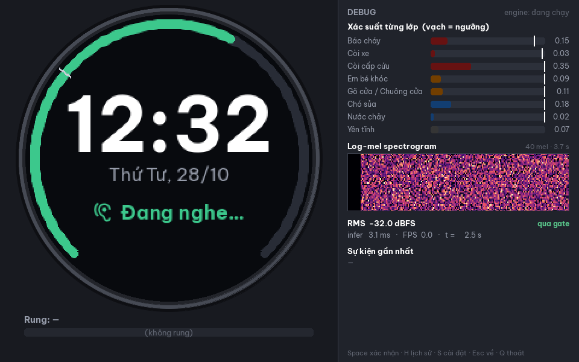
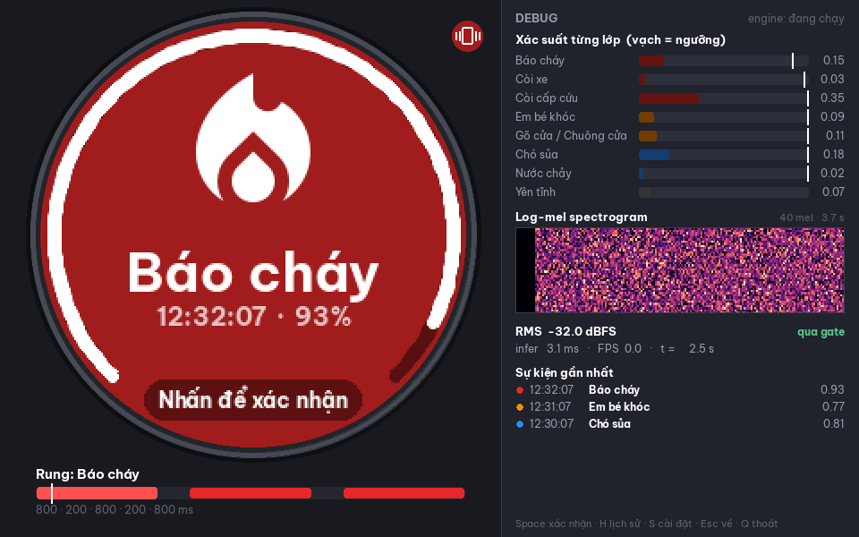
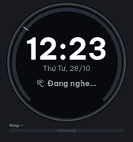
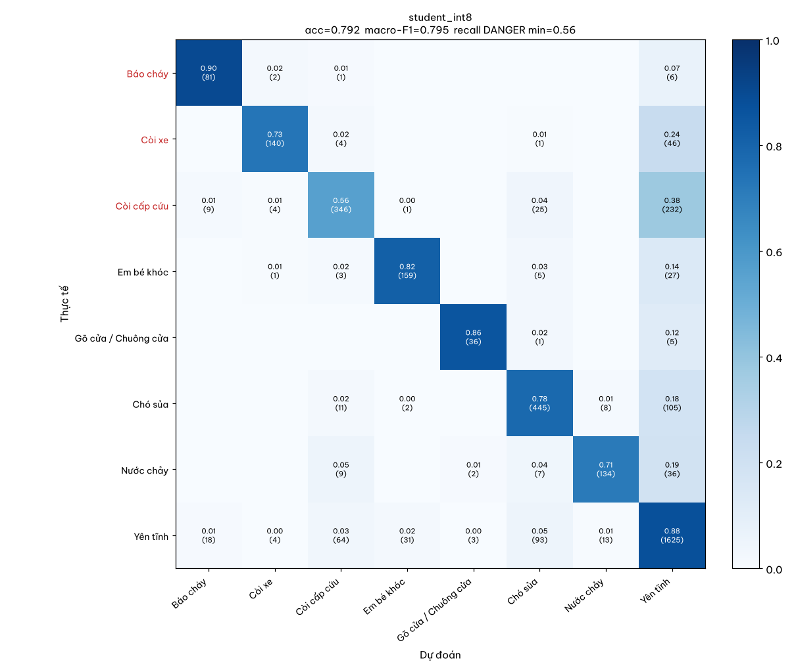

# SoundWatch – đồng hồ nhận diện âm thanh cho người khiếm thính (PoC)

Đề tài môn AI cho hệ thống nhúng. SoundWatch nghe âm thanh môi trường (16 kHz, cửa sổ 1 s, cập nhật mỗi 0.5 s),
nhận diện **7 âm cảnh báo + nền** và cảnh báo trên mặt đồng hồ bằng icon, nhãn tiếng Việt, màu theo mức nguy hiểm
và mẫu rung:

| Mức | Lớp |
|---|---|
| DANGER (đỏ, nhấp nháy, lặp tới khi xác nhận) | Báo cháy (`smoke_alarm`), Còi xe (`car_horn`), Còi cấp cứu (`siren`) |
| WARN (cam) | Em bé khóc (`baby_cry`), Gõ cửa / Chuông cửa (`door_knock`) |
| INFO (xanh) | Chó sủa (`dog_bark`), Nước chảy (`water_running`) |

Bản PoC chạy **hoàn toàn trên máy tính**: pipeline train (YAMNet teacher → DS-CNN student, distill, int8), engine
real-time dùng **đúng file `.tflite` int8** sẽ nạp xuống MCU, và cửa sổ pygame mô phỏng mặt đồng hồ tròn 240×240.
Cùng model đó còn chạy trên **iPhone thật** qua app SwiftUI trong [`ios/`](ios/README.md).
Phần cứng đích: **ESP32-S3 có PSRAM** + TFLite Micro / ESP-NN. Kế hoạch chi tiết, contract và trạng thái:
[docs/IMPLEMENTATION_PLAN.md](docs/IMPLEMENTATION_PLAN.md).

| Đang nghe | Cảnh báo | Demo (kịch bản mẫu) |
|---|---|---|
|  |  |  |

## Cài đặt

Cần [uv](https://docs.astral.sh/uv/) (Python 3.11 được uv tự cài). Mọi version đã pin trong `pyproject.toml` / `uv.lock`.

```bash
uv sync                      # = make install
make test                    # pytest headless (~1 phút)
uv run python -m soundwatch doctor   # kiểm tra TF, YAMNet, micro, pygame
```

Micro thật cần PortAudio (`sudo apt install libportaudio2` trên Linux); mọi thứ khác chạy không cần micro.

## Chạy demo ngay (model có sẵn, không cần train)

Repo kèm sẵn model int8 `assets/models/student_int8.tflite` (208 KB) + `feature_stats.json` và kịch bản mẫu
`assets/demo/demo_scenario.wav` (60 s, mỗi lớp một sự kiện ở SNR 10 dB). Khi `artifacts/models/` chưa có model đã
train, lệnh `run` tự dùng model có sẵn.

```bash
make demo-file        # UI + kịch bản mẫu  (= uv run python -m soundwatch run --source assets/demo/demo_scenario.wav)
make demo             # UI + micro máy tính (cần PortAudio)
make demo-headless    # không UI: in cảnh báo ra console, chạy nhanh nhất có thể (--headless --fast)
make demo-ui          # chỉ UI với sự kiện giả (không cần model/engine)
make demo-gif         # quay cửa sổ UI thành artifacts/reports/demo.gif (chạy được headless)
```

Điều khiển UI: `Space`/click = xác nhận cảnh báo, `H` lịch sử, `S` cài đặt (bật/tắt từng lớp), `Esc` về màn hình chính,
`Q` thoát. Không có màn hình: `SDL_VIDEODRIVER=dummy uv run python -m soundwatch run --source … --max-seconds 70`.

Kết quả `make demo-headless` (model có sẵn, config hiện tại) so với nhãn `assets/demo/demo_scenario.csv`:

| Lớp | Âm thanh (s) | Cảnh báo đầu tiên (s) | Độ trễ (s) |
|---|---|---|---|
| smoke_alarm – Báo cháy | 2.00–5.50 | 3.0 | 1.00 |
| car_horn – Còi xe | 10.89–14.39 | 12.0 | 1.11 |
| siren – Còi cấp cứu | 19.78–23.28 | 22.0 | 2.22 |
| baby_cry – Em bé khóc | 28.67–32.17 | 30.5 | 1.83 |
| door_knock – Gõ cửa | 37.56–39.22 | 39.0 | 1.44 |
| dog_bark – Chó sủa | 44.61–48.11 | **bỏ sót** | – |
| water_running – Nước chảy | 53.50–57.00 | 56.0 | 2.50 |

6/7 sự kiện được phát hiện, không báo nhầm. Nhờ luật hai tầng (mục "Hậu xử lý"), ba lớp DANGER báo sớm hơn 0.5 s so
với chỉ dùng k-of-n. Các lớp DANGER còn được nhắc lại mỗi 5 s (`[repeat]`) tới khi xác nhận. Chạy real-time có UI cho cùng kết quả, UI đạt 30 FPS (giới hạn của vòng lặp; khả năng ~160 FPS).
(`t` của cảnh báo là thời điểm **cuối** cửa sổ 1 s đang phân tích.)

## Toàn bộ pipeline

```bash
make data       # tải ESC-50, UrbanSound8K, FSD50K chọn lọc (~170 MB) → cửa sổ 1 s + split theo fold + noise bank
make train      # teacher YAMNet+head, student DS-CNN có distill và không distill (CPU: ~1–1.5 giờ)
make quantize   # int8 TFLite + header C cho firmware + icons + golden vectors
make eval       # kịch bản test, đánh giá offline + streaming, phân tích báo nhầm, benchmark, report
make tune       # (tuỳ chọn) kịch bản val + quét hậu xử lý → artifacts/reports/tuning.md
make all        # data → train → quantize → eval
```

`make data-quick` (chỉ ESC-50) để thử pipeline trong vài phút. Mọi kết quả nằm trong `artifacts/` (không commit):
báo cáo tổng hợp `artifacts/reports/report.md`.

## Lệnh CLI (`uv run python -m soundwatch <lệnh> --help`)

| Lệnh | Việc |
|---|---|
| `doctor` | kiểm tra môi trường (TF, YAMNet, micro, pygame headless) |
| `download`, `build-dataset` | tải dataset; cắt cửa sổ 1 s, chia split, noise bank (`--quick`, `--with-fsd50k`) |
| `train-teacher`, `train-student` | YAMNet + head; DS-CNN student (`--distill` / `--no-distill`) |
| `quantize`, `export`, `export-icons`, `export-golden` | int8 TFLite; `model_data.cc`, `feature_params.h`, `labels.h`; `icons.h`; golden vectors |
| `make-scenarios` | sinh kịch bản streaming (`--split test|val`, `--out`, `--no-demo`; sự kiện ngắn: `--classes danger --event-lengths 0.5,1,1.5`) |
| `eval`, `eval-streaming` | đánh giá offline (F1, confusion matrix); streaming (recall sự kiện, báo nhầm/giờ, độ trễ, quét ngưỡng) |
| `tune` | quét smooth_n × k_of_n × bg_margin × ngưỡng từng lớp trên kịch bản **val** |
| `eval-fast-path` | so sánh trước/sau luật hai tầng DANGER trên test, val và kịch bản sự kiện ngắn → `artifacts/reports/fast_path.json` |
| `fa-analysis` | truy báo nhầm trên nền về clip gốc + chấm bằng YAMNet |
| `benchmark`, `report` | kích thước / MACs / thời gian / ước tính MCU; gom `report.md` (`--measure-ui-fps`) |
| `run` | engine real-time + UI (`--source mic|file.wav`, `--headless`, `--fast`, `--dummy`, `--record-gif`, `--ui-stats`) |
| `record` | thu âm micro → `artifacts/data/custom/<lớp>/<thời điểm>.wav` (16 kHz) |

## Cấu trúc thư mục

```
config/soundwatch.yaml     # MỌI tham số: audio/feature, hậu xử lý, model, UI, lớp (nhãn, icon, màu, rung, ngưỡng)
assets/                    # icons (Material Icons), font Be Vietnam Pro, model int8 có sẵn, kịch bản demo
docs/                      # kế hoạch triển khai, số liệu luật hai tầng, kế hoạch còi VN, ảnh cho README
ios/                       # app iPhone (SwiftUI + LiteRT C), xem ios/README.md
src/soundwatch/
  audio/   features.py (log-mel numpy thuần), sources.py (mic/file/array), ringbuffer.py
  data/    download, label_map, build_dataset, augment, fsd50k, scenarios
  models/  yamnet_loader, teacher, dscnn, train, distill, quantize, export_c
  engine/  classifier (TFLite/Keras/Dummy), postprocess, pipeline (Engine), logger, run
  ui/      app (vòng lặp pygame), screens, widgets, theme, vibration, debug
  eval/    offline, streaming, tune, fa_analysis, benchmark, report
  tools/   doctor, export_icons, export_golden, record
tests/                     # pytest, headless, không cần mạng
artifacts/                 # (gitignore) data, cache, models, firmware, reports, logs
```

## Kết quả (test split, student int8)

Chi tiết và đối chiếu mục tiêu: `artifacts/reports/report.md` (sinh bởi `make eval`).

| Chỉ số | Kết quả | Mục tiêu |
|---|---|---|
| Macro-F1 / accuracy (cửa sổ 1 s) | 0.795 / 0.792 (teacher YAMNet 0.823) | ≥ 0.80 |
| Recall offline smoke_alarm / car_horn / siren | 0.90 / 0.73 / 0.56 | ≥ 0.85 |
| Sụt float → int8 | +0.08 điểm % | ≤ 2 |
| Model int8 / tensor arena / MACs | 208 KB / ~117 KB / 24.5 M | ≤ 500 KB / 512 KB / 50 M (ESP32-S3) |
| Streaming: recall sự kiện (tổng / DANGER TB) | 0.42 / 0.59 | – |
| Sự kiện DANGER ngắn 0.5–1.5 s: recall / trễ median | 0.38 / 0.81 s | – |
| Báo nhầm / giờ (chỉ âm nền) | 32 (23 nếu tắt luật hai tầng) | ≤ 2 |
| Độ trễ onset → cảnh báo (median / p90) | 1.25 s / 3.0 s | ≤ 1.5 s |
| Feature + suy luận trên PC | ~0.5 ms / cửa sổ | ≤ 20 ms |
| UI | 30 FPS | ≥ 30 |
| Ước tính ESP32-S3 240 MHz + ESP-NN | ~51–102 ms / suy luận | – |

### Hậu xử lý

Tham số trong `config/soundwatch.yaml` được chọn trên kịch bản **val**, không dùng test:

- `tune`: smooth_n 1, k_of_n 2/2 (2 hop liên tiếp trên ngưỡng), ngưỡng 0.90–0.99. Muốn trễ median ≤ 1.5 s thì không
  cấu hình nào đạt ≤ 2 hay ≤ 5 báo nhầm/giờ trên val, nên đã chọn ngân sách 10/giờ.
- **Luật hai tầng cho DANGER** (`danger_fast_threshold: 0.99609375`, quy tắc 4b trong `engine/postprocess.py`): lớp
  DANGER báo ngay ở **một** hop có xác suất bão hoà 255/256, không chờ đủ 2 hop. Lý do: xe cấp cứu chạy vụt qua chỉ
  kêu khoảng 1 s. Trên val: recall DANGER 0.55 → 0.62, sự kiện DANGER ngắn 0.32 → 0.50, trễ median của siren 1.71 →
  1.04 s; đổi lại báo nhầm trên nền 10 → 18/giờ (test 23 → 32/giờ). Đặt `null` để tắt. Số liệu đầy đủ:
  [docs/danger_fast_path.md](docs/danger_fast_path.md).



## Xuất cho firmware

`make quantize` ghi vào `artifacts/firmware/`:

| File | Nội dung |
|---|---|
| `model_data.cc/.h` | `alignas(16) const unsigned char g_model[]` (model int8 cho TFLite Micro) |
| `feature_params.h` | hằng số feature (16 kHz, n_fft 512, step 320, 40 mel HTK 20–8000 Hz, 49 frame), mean/std, scale/zero-point input, tham số hậu xử lý |
| `labels.h` | tên lớp, mức, ngưỡng, cooldown, mẫu rung |
| `icons.h` + `icons_preview.png` | icon XBM 1-bit 48×48 (OLED SSD1306 / U8g2) và RGB565 96×96 (TFT GC9A01) |
| `artifacts/golden/` | 5 cửa sổ mẫu: `input.wav`, `logmel.npy`, mảng C, để kiểm tra bản C của feature trên MCU |

## Ánh xạ PC → firmware

| Module PC | Trên MCU |
|---|---|
| `MicSource` | driver I2S/PDM + DMA (ESP32-S3 I2S) |
| `RingBuffer` | buffer vòng int16 tĩnh 16000 mẫu (32 KB) |
| `compute_logmel` | FFT (ESP-DSP / CMSIS-DSP) + mel filterbank thưa; kiểm bằng golden vectors |
| `TFLiteClassifier` | TFLite Micro + ESP-NN với `model_data.cc` (arena trong SRAM/PSRAM) |
| `PostProcessor` | port nguyên logic sang C (smoothing, k-of-n, cooldown, lặp DANGER) |
| Energy gate | RMS trên block DMA, cho CPU ngủ khi yên tĩnh |
| UI pygame | LVGL (TFT tròn) hoặc U8g2 (OLED) với `icons.h` |
| Mô phỏng rung | motor ERM/LRA qua DRV2605 hoặc GPIO + transistor |
| Thread + `queue.Queue` | FreeRTOS task + queue |

## App iPhone

`ios/` là app SwiftUI chạy đúng `student_int8.tflite` trên micro iPhone (LiteRT C API, feature bằng Accelerate),
port nguyên PostProcessor (kể cả luật hai tầng) và đọc tham số từ `ios/SoundWatch/Resources/soundwatch_config.json`.
Khi đổi config hoặc model ở phía Python, chạy lại `uv run python ios/scripts/export_ios_assets.py` để cập nhật tài
nguyên của app. Build, cài bằng Apple ID miễn phí (USB hoặc Wi-Fi) và XCTest: xem [ios/README.md](ios/README.md).

Đã chạy trên iPhone 12 (Release): feature + suy luận khoảng 4 ms mỗi hop. "Phát file demo" cho 12/12 cảnh báo trùng
bản Python (6/7 âm, cùng thời điểm).

## Thu dữ liệu thật (giảm lệch miền)

```bash
uv run python -m soundwatch record --class door_knock --seconds 5 --count 10   # = make record CLASS=door_knock COUNT=10
uv run python -m soundwatch record --class background --seconds 10 --count 20
```

Clip được lưu ở `artifacts/data/custom/<lớp>/<YYYYmmdd-HHMMSS>.wav` (16 kHz mono). `build-dataset` chưa đọc thư
mục này. Cách dùng dự kiến: cắt cửa sổ 1 s như các clip khác rồi thêm vào `train.npz`, giữ lại vài bản ghi mỗi lớp
làm tập test "micro thật". Sau đó fine-tune vài epoch từ `student_distill.keras` với learning rate nhỏ và quantize
lại. Kế hoạch cụ thể cho còi xe ưu tiên Việt Nam (lượng dữ liệu, chia tập theo buổi thu, chế độ thu clip trên
iPhone): [docs/vn_siren_finetune.md](docs/vn_siren_finetune.md).

## Hạn chế

- `siren` yếu nhất (recall offline 0.56) và gây nhiều báo nhầm nhất. Model nhầm các âm có cao độ ổn định (nhạc đường
  phố, máy khoan, điều hoà, động cơ) thành còi. `fa-analysis` với YAMNet cho thấy chỉ ~6 % báo nhầm là do nhiễu
  nhãn (nền thật sự có còi/chó). Phần còn lại là lỗi của model.
- Model int8 quá tự tin (xác suất bão hoà ở 0.996), nên chỉnh ngưỡng không giảm được báo nhầm về mức 2/giờ. Luật
  hai tầng làm báo nhầm tăng thêm khoảng 8–9 lần/giờ.
- Model chỉ học còi nước ngoài, nên còi xe ưu tiên Việt Nam có thể bị bỏ sót (xem `docs/vn_siren_finetune.md`).
- `smoke_alarm` một phần vẫn dùng proxy ESC-50 `clock_alarm`. FSD50K chỉ được tải chọn lọc (baby_cry, smoke_alarm).
- Kịch bản streaming là âm tổng hợp, chỉ ~1 giờ nền test, nên số báo nhầm/giờ có sai số lớn.
- App đã chạy micro thật trên iPhone 12, nhưng chưa đo định lượng lệch miền (bỏ sót / báo nhầm với âm thật).
- Softmax single-label: không xử lý nhiều âm cùng lúc.

## Giấy phép

- Mã nguồn: theo repo.
- Dataset (không phân phối lại, tải bằng `make data`): ESC-50 **CC BY-NC 3.0**, UrbanSound8K **CC BY-NC 3.0**,
  FSD50K: giấy phép Creative Commons theo từng clip (CC0 / CC BY / CC BY-NC). Kịch bản demo
  `assets/demo/demo_scenario.wav` được trộn từ các clip này, nên cũng chỉ dùng phi thương mại (NC).
- Icon: Google Material Icons, **Apache-2.0** (`assets/icons/LICENSE`, `SOURCES.md`).
- Font: Be Vietnam Pro, **SIL OFL 1.1** (`assets/fonts/OFL.txt`).
- YAMNet (trọng số + code TensorFlow Models): **Apache-2.0**.
