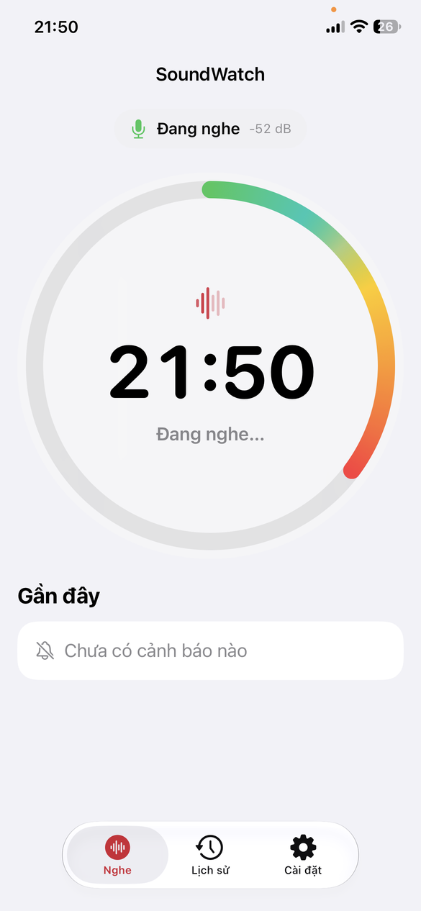
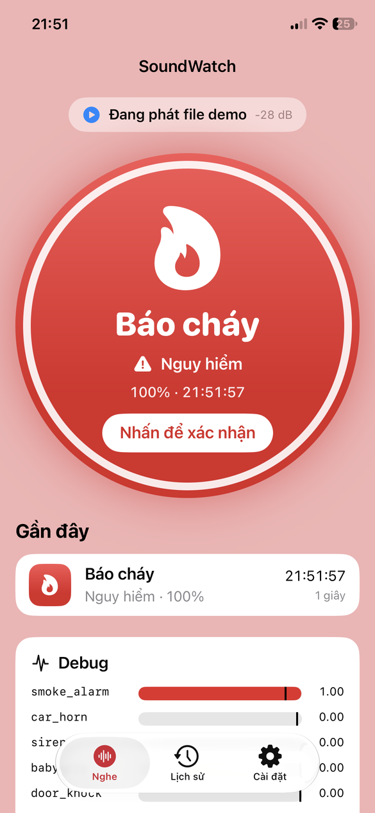
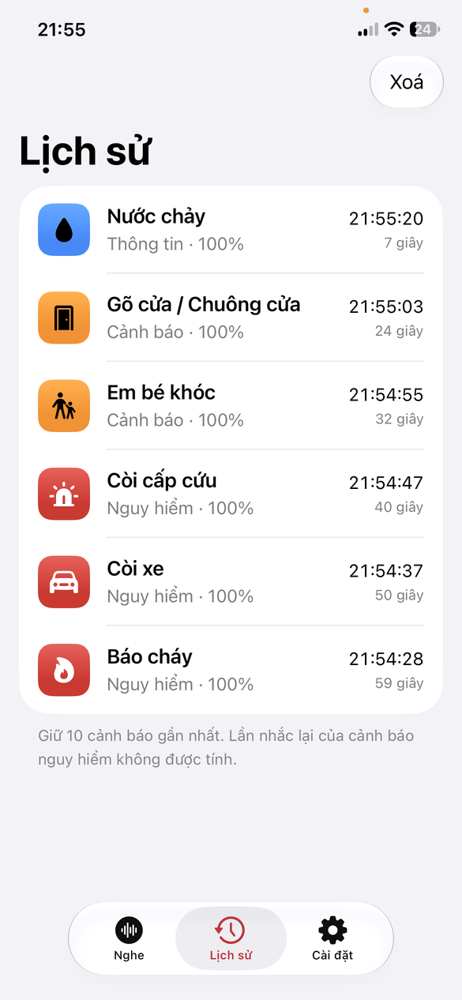
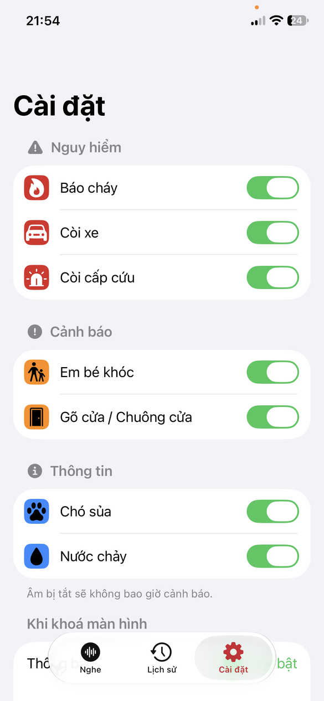
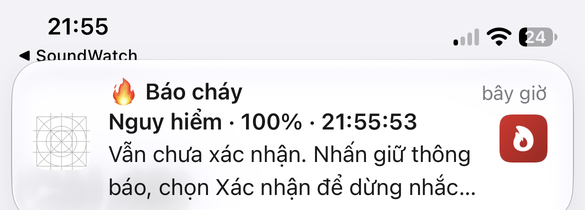
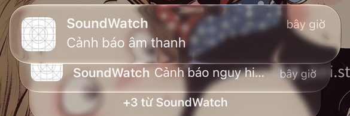

# SoundWatch iOS (PoC trên iPhone)

App iOS chạy đúng model `assets/models/student_int8.tflite` (DS-CNN int8, cùng file sẽ nạp cho ESP32-S3) trên âm thanh
micro iPhone, theo pipeline của bản Python: 16 kHz, cửa sổ 1 s, hop 0.5 s, gate −55 dBFS, log-mel 49×40,
PostProcessor (k-of-n, cooldown, DANGER lặp tới khi xác nhận; DANGER báo ngay ở một hop bão hoà 255/256, quy tắc 4b,
`danger_fast_threshold`). Cảnh báo bằng icon, nhãn tiếng Việt, màu theo mức, rung
Core Haptics. Khi khoá màn hình thì gửi notification.

## Cấu trúc

```
ios/
  project.yml                 XcodeGen (target iOS 17, SwiftUI)
  Config.xcconfig             bundle id / team mặc định; ghi đè bằng Local.xcconfig (không commit)
  Local.xcconfig.example
  Packages/LiteRTC/           Swift package bọc thư viện C LiteRT (TensorFlowLiteC.xcframework do script tạo)
  scripts/
    export_ios_assets.py      sinh SoundWatch/Resources từ repo Python
    fetch_litert.sh           tải LiteRT C chính thức, kiểm SHA-256, đóng gói lại xcframework tĩnh
    make_app_icon.py          vẽ icon app (light / dark / tinted) và logo launch screen
  docs/screenshots/           ảnh chụp trên iPhone 12
  SoundWatch/
    App/        SoundWatchApp, AppState (ObservableObject)
    Core/       SoundWatchConfig, RingBuffer, FeatureExtractor (Accelerate), TFLiteClassifier,
                PostProcessor, Engine, WavReader
    Audio/      AudioCapture (AVAudioEngine → 16 kHz), DemoFilePlayer
    Services/   Haptics (Core Haptics), Notifier (local notification)
    UI/         ContentView (tab Nghe / Lịch sử / Cài đặt, mặt đồng hồ, debug), Theme (màu, độ tương phản)
    Assets.xcassets  AppIcon, LaunchLogo, LaunchBackground, AccentColor
    SoundWatch.entitlements   Time Sensitive (chỉ dùng với team trả phí, xem dưới)
    Resources/  student_int8.tflite, soundwatch_config.json, demo_scenario.wav,
                golden_features.json, demo_expected_events.json (2 file cuối chỉ cho test)
  SoundWatchTests/            XCTest: golden feature, classifier, postprocessor, end-to-end
```

## TFLite / LiteRT

Dùng **thư viện C của LiteRT 2.3.0** (`TensorFlowLiteC.xcframework`, chính là binary mà Swift package chính thức
`google-ai-edge/LiteRT` tag v2.3.2 tải về, cùng URL và checksum), gọi C API từ Swift, delegate XNNPACK như interpreter
Python. Không dùng thẳng package chính thức vì:

- SPM phải clone cả repo LiteRT (~460 MB) và đòi Git LFS nằm trong toolchain của Xcode;
- Xcode nhúng framework tĩnh của package như framework động rồi báo lỗi thiếu `Info.plist`;
- wrapper Swift `TensorFlowLite` của package không có kiểu tensor `int8`, nên không chạy được model full int8.

`scripts/fetch_litert.sh` tải zip chính thức, kiểm SHA-256, rồi đóng gói lại cùng file `.a` thành xcframework thư viện
tĩnh. `xcodegen generate` tự chạy script này (`preGenCommand`). Không dùng CocoaPods, không convert sang Core ML.

## Build lại từ đầu

Cần Mac có Xcode 15+ (đã thử Xcode 27.1), Homebrew, [uv](https://docs.astral.sh/uv/).

```bash
brew install xcodegen
cd soundwatch
uv run ios/scripts/export_ios_assets.py   # chỉ cần khi đổi model/config; Resources đã commit sẵn
cd ios
cp Local.xcconfig.example Local.xcconfig  # sửa SW_BUNDLE_ID (và SW_TEAM_ID nếu biết)
xcodegen generate                         # tự tải LiteRT lần đầu (~7 MB)
open SoundWatch.xcodeproj
```

`uv sync` của repo không chạy trên macOS vì `tensorflow-cpu` không có wheel cho Mac. Script export khai báo dependency
riêng (PEP 723, dùng `ai-edge-litert` 2.3.0) nên chạy được bằng `uv run` như trên. Trên Linux vẫn chạy được bằng
`uv sync && uv run python ios/scripts/export_ios_assets.py`.

Không cần CocoaPods và không có `.xcworkspace`: mở thẳng `SoundWatch.xcodeproj`.

## Cài lên iPhone (Apple ID miễn phí)

Chuẩn bị một lần:

1. **Cắm cáp** iPhone vào Mac (bắt buộc lần đầu), mở khoá iPhone, bấm **Trust** và nhập passcode.
2. iPhone: Settings → Privacy & Security → **Developer Mode** → bật, khởi động lại, xác nhận "Turn On". Mục này chỉ
   hiện sau khi iPhone đã kết nối với Xcode ít nhất một lần (bước 1).
3. Xcode → Settings → Accounts → **+** → Apple ID → đăng nhập. Xcode tạo "Personal Team" và chứng chỉ Apple Development.
   Dòng lệnh `xcodebuild` cũng dùng tài khoản này; chưa đăng nhập thì báo `No Accounts`.
4. `Local.xcconfig`: `SW_BUNDLE_ID` (bundle id riêng, ví dụ `com.<tên>.soundwatch`) và `SW_TEAM_ID` (Team ID của
   Personal Team, xem ở Xcode → Settings → Accounts, hoặc để trống rồi chọn team trong Xcode), sau đó
   `xcodegen generate`.

Cài và chạy từ Xcode:

5. Chọn iPhone ở thanh trên, scheme SoundWatch. Product → Scheme → Edit Scheme → Run → Build Configuration =
   **Release** (đo thời gian đúng hơn Debug) → Run.
6. Lần đầu iPhone báo "Untrusted Developer": Settings → General → VPN & Device Management → Apple ID của bạn → Trust.
7. Mở app, cho phép **Micro** và **Thông báo**.

Profile của Personal Team hết hạn sau 7 ngày: trước buổi báo cáo phải build và cài lại.

### Qua Wi-Fi (không cắm cáp)

Sau khi đã pair bằng cáp một lần (bước 1–2), Mac và iPhone cùng mạng Wi-Fi là đủ:

- Xcode → Window → Devices and Simulators → chọn iPhone → bật **Connect via network** (Xcode 15 trở lên thường tự bật).
  Rút cáp; iPhone vẫn hiện trong danh sách thiết bị, có biểu tượng mạng.
- Kiểm tra từ dòng lệnh: `xcrun devicectl list devices` phải thấy iPhone ở trạng thái `available (paired)`, và
  `xcrun devicectl device info details --device <UDID>` có `Transport Type: localNetwork`, `Developer Mode Status: Enabled`.
- iPhone phải đang mở khoá khi cài và khi Xcode khởi chạy app. Nếu máy không hiện: mở khoá iPhone, tắt/bật Wi-Fi, hoặc
  cắm cáp lại một lần.
- Build và cài như mục dưới, `--device` là UDID hoặc tên máy.

### Bằng dòng lệnh

```bash
xcrun devicectl list devices                     # lấy UDID của iPhone
xcodebuild -project SoundWatch.xcodeproj -scheme SoundWatch -configuration Release \
  -destination 'id=<UDID>' -derivedDataPath build -allowProvisioningUpdates build
xcrun devicectl device install app --device <UDID> build/Build/Products/Release-iphoneos/SoundWatch.app
xcrun devicectl device process launch --device <UDID> <SW_BUNDLE_ID>
xcrun devicectl device process launch --device <UDID> <SW_BUNDLE_ID> -- -demo   # mở và phát file demo
```

Bundle id và team lấy từ `Local.xcconfig`. Lần đầu `-allowProvisioningUpdates` tạo App ID và provisioning profile
(Personal Team: tối đa 10 App ID trong 7 ngày).

`-allowProvisioningUpdates` cần Apple ID đã đăng nhập trong Xcode ít nhất một lần.

## Test

```bash
xcodebuild test -project SoundWatch.xcodeproj -scheme SoundWatch \
  -destination 'platform=iOS Simulator,name=iPhone 15'
```

Đổi `name=` theo simulator có trên máy (`xcrun simctl list devices available`). Simulator chỉ chạy được trên Mac Apple
silicon (LiteRT không có lát x86_64 cho simulator).

| Test | Kiểm |
|---|---|
| `FeatureExtractorTests` | log-mel so với 5 golden case của `export-golden`, max \|diff\| < 1e-3; silence = log(1e-6); RingBuffer; thời gian feature + suy luận < 20 ms |
| `ClassifierTests` | input golden case 4 đã chuẩn hoá → xác suất khớp Python `TFLiteClassifier` trong ±1/256; SF Symbols tồn tại |
| `PostProcessorTests` | port `tests/test_wp5_postprocess.py`: 8 test cũ (tham số của `tests/_legacy_cfg.py`, tắt luật 4b) + `bg_margin`, và 7 test `test_fast_path_*` (cấu hình đã tune, `dangerFastThreshold` = 255/256) |
| `EndToEndTests` | Engine offline trên `demo_scenario.wav`: sự kiện không lặp khớp `demo_expected_events.json` (cùng lớp, cùng hop: lệch ≤ 0.25 s); tắt luật 4b thì test này fail |
| `ThemeTests` | mọi SF Symbol dùng trong UI tồn tại; chữ trên nền cảnh báo đạt tương phản ≥ 4.5:1 |

Kết quả (Xcode 27.1, simulator iOS 27.1, Mac Apple silicon):

| Mục | Kết quả |
|---|---|
| Golden log-mel, max \|diff\| (silence / sine / noise / chirp / sum_of_sines) | 0 / 9.5e-7 / 4.8e-7 / 9.5e-7 / 9.5e-7 |
| Classifier golden case 4 | trùng từng giá trị với Python |
| Demo 60 s: xác suất từng hop (119 hop) | lệch tối đa 1/256 so với file kỳ vọng (sinh trên Linux; sinh trên Mac thì lệch 0), cùng các hop bị gate |
| Demo 60 s: sự kiện | 12/12 trùng Python (6 sự kiện mới + 6 lần nhắc DANGER), cùng thời điểm. Có luật 4b: smoke_alarm 3.0 s, car_horn 12.0 s, siren 22.0 s (sớm hơn 0.5 s so với trước) |
| Feature + suy luận / hop, Release | 0.20 ms + 0.63 ms (Debug: 5.7 + 1.3 ms) |

Trên iPhone 12 (iOS 27.0.1, bản Release, cài qua Wi-Fi):

| Mục | Kết quả |
|---|---|
| Quyền micro | Hiện hộp thoại tiếng Việt; sau khi cho phép thì nghe liên tục (RMS, gate cập nhật mỗi 0.5 s) |
| "Phát file demo" (real-time, `-demo`) | 12/12 sự kiện trùng Python: 6/7 âm, cùng thời điểm, kể cả các lần nhắc DANGER ; có luật 4b: DANGER ở 3.0 / 12.0 / 22.0 s, đúng `demo_expected_events.json` |
| Feature + suy luận / hop (Debug panel) | ~0.9 ms + ~3.2 ms, tối đa 4.9 ms |

Log cảnh báo (`SW_ALERT ...`) xem bằng `xcrun devicectl device process launch --console --device <UDID> <SW_BUNDLE_ID>`.

Thử tay luật 4b trên máy (chưa làm, cần người phát âm thật):

- [ ] Còi cấp cứu / còi xe **vụt qua 1–2 s** (xe thật hoặc clip từ loa máy khác, cách 1–3 m): ghi âm gì, dài bao nhiêu,
  có báo không, độ trễ nhìn thấy. Bật bảng Debug: cảnh báo phải hiện ngay hop đầu tiên thanh `siren`/`car_horn` chạm
  đỉnh (1.00), không cần 2 hop.
- [ ] Nghe nền 15–30 phút (trong nhà, rồi ngoài đường), không có còi thật: đếm số lần báo nhầm DANGER (tab Lịch sử giữ 10
  dòng; hoặc đếm dòng `SW_ALERT` không có `repeat` qua `devicectl … --console`). Số đo trên máy trước khi có luật: chưa
  có. Trên kịch bản tổng hợp, luật tăng báo nhầm khoảng +8–9 lần/giờ (`docs/danger_fast_path.md`).

## Dùng app

| Đang nghe | Cảnh báo nguy hiểm | Lịch sử | Cài đặt |
|---|---|---|---|
|  |  |  |  |

| Notification khi app chạy nền | Màn hình khoá (bản xem trước đang ẩn) |
|---|---|
|  |  |

- 3 tab: **Nghe**, **Lịch sử**, **Cài đặt**. Có cảnh báo mới thì app tự về tab Nghe. Hỗ trợ light/dark mode và
  Dynamic Type.
- **Nghe**: trạng thái (đang nghe / đang phát demo / micro tắt, kèm mức dB), mặt đồng hồ tròn với giờ và vòng cung âm
  lượng (−80…0 dBFS, xanh → đỏ), 3 cảnh báo gần nhất, bảng debug nếu bật.
- **Cảnh báo**: nền màu theo mức, icon lớn, nhãn tiếng Việt cỡ largeTitle, mức độ, độ tin cậy, giờ phát hiện. Chữ trên
  nền đạt độ tương phản ≥ 4.5:1 (đỏ DANGER được làm đậm để chữ trắng đọc được; cam/xanh dùng chữ đen). DANGER nhấp nháy
  2 Hz, cả nền trang cũng nháy, và giữ tới khi chạm "Nhấn để xác nhận" (ack về PostProcessor, dừng nhắc lại). Bật
  Reduce Motion thì không nháy, chỉ giữ viền sáng. WARN/INFO tự tắt sau 6 s.
- Rung theo mẫu `vibration` của từng lớp (xem mục Rung bên dưới): DANGER rung lặp liên tục tới khi xác nhận, WARN/INFO
  rung một lần.
- **Lịch sử**: 10 sự kiện gần nhất, giờ và "bao lâu trước", nút Xoá.
- **Cài đặt**: bật/tắt từng lớp theo nhóm mức độ (lưu giữa các lần mở), trạng thái quyền thông báo, bật bảng debug,
  phát file demo, thông tin model.
- **Debug**: xác suất 8 lớp với vạch ngưỡng, RMS dBFS, cờ gated, thời gian feature/suy luận (và max mỗi hop), nút
  "Phát file demo". Khi phát demo, micro vẫn chạy nhưng mẫu của micro bị bỏ qua; hết file thì nghe micro tiếp. Nhờ
  vậy chuyển nguồn không phải khởi động lại ghi âm (iOS không cho bắt đầu ghi âm khi app đang ở nền).

### Notification (app chạy nền / khoá màn hình)

`UIBackgroundModes: audio` giữ micro chạy khi khoá màn hình. Mỗi cảnh báo (mọi mức) gửi một notification:

- tiêu đề: emoji + nhãn ("🔥 Báo cháy"); subtitle: mức độ · độ tin cậy · giờ; nội dung: việc cần làm;
- ảnh đính kèm: icon của lớp trên nền màu của mức độ;
- gom nhóm theo lớp (`threadIdentifier`). DANGER chỉ giữ một notification mỗi lớp, lần nhắc lại thay thế lần trước;
- nhấn giữ: DANGER có **Xác nhận** (ack PostProcessor, dừng nhắc lại), WARN/INFO có **Đã thấy**. Chạm vào notification
  thì mở app và hiện lại cảnh báo;
- rung: xem mục Rung.

Nếu iPhone đặt "Hiện bản xem trước: Khi được mở khoá" (mặc định), màn hình khoá chỉ hiện "Cảnh báo nguy hiểm" /
"Cảnh báo âm thanh". Muốn thấy đủ nhãn khi đang khoá: Cài đặt → Thông báo → SoundWatch → Hiện bản xem trước → Luôn luôn.

**Time Sensitive**: code đặt `interruptionLevel = .timeSensitive` cho DANGER (vượt qua Focus / tóm tắt theo lịch), nhưng
cần entitlement `com.apple.developer.usernotifications.time-sensitive`. Đã thử: Personal Team (Apple ID miễn phí) **không
ký được** ("Personal development teams … do not support the Time Sensitive Notifications capability"). Vì vậy mặc định
tắt; iOS tự hạ về mức `.active`. Có tài khoản Apple Developer Program thì thêm
`SW_ENTITLEMENTS = SoundWatch/SoundWatch.entitlements` vào `Local.xcconfig`.

**Critical Alerts** (kêu cả khi tắt tiếng / Không làm phiền) cần Apple duyệt entitlement riêng, nên không làm.

### Rung

Thu âm và rung chạy cùng lúc chỉ khi audio session gọi `setAllowHapticsAndSystemSoundsDuringRecording(true)`
(`AudioCapture.configureSession`). Thiếu dòng này thì iOS nuốt cả Core Haptics lẫn `kSystemSoundID_Vibrate` mà không báo
lỗi. Đã thử trên iPhone 12: không có dòng đó thì không rung, có thì rung.

| Mức | Rung |
|---|---|
| DANGER | Lặp mẫu `vibration` của lớp liên tục (nghỉ 0.6 s giữa hai lần) tới khi xác nhận, tối đa 30 s kể từ cảnh báo của lớp đó (mặc định). App mở: Core Haptics, cường độ 1.0. App ở nền / khoá máy: `kSystemSoundID_Vibrate` lặp theo timer (Core Haptics không chạy ở nền; app vẫn sống nhờ đang thu âm) |
| WARN / INFO | Mẫu `vibration` một lần (cường độ 0.7 / 0.5); ở nền: một lần rung hệ thống |

- Xác nhận (chạm mặt đồng hồ, hoặc "Xác nhận" trên notification) dừng **mọi** rung DANGER đang chạy và ack các lớp đó,
  vì mặt đồng hồ chỉ hiện cảnh báo mới nhất. DANGER mới tới sau đó lại rung.
- Cài đặt → "Rung khi nguy hiểm": mặc định **tối đa 30 giây** (Dinh chọn); có thêm 1 phút, 2 phút, "Đến khi xác nhận".
  Hết thời gian thì lớp đó im hẳn: các lần nhắc lại sau đó không rung, notification nhắc lại cũng không kêu, cho tới khi
  xác nhận hoặc có cảnh báo mới của lớp đó. Mỗi lớp tính 30 s riêng.
- Kết quả thử trên iPhone 12 (iOS 27.0.1) với nút "Phát file demo":

| Trạng thái | Kết quả |
|---|---|
| Mở app, chuông bật | rung lặp liên tục; xác nhận thì dừng ngay |
| Khoá máy, chuông bật | rung lặp liên tục; "Xác nhận" trên notification dừng |
| Khoá máy, công tắc Im lặng | rung lặp liên tục; một lần "Xác nhận" dừng hết |
| Mở app, không xác nhận, giới hạn 30 s | báo cháy / còi xe / còi cấp cứu lần lượt tự hết rung sau 30 s; sau đó không rung lặp nữa |
| Chế độ Tập trung (Không làm phiền) | chưa thử |

### Launch argument

| Argument | Tác dụng |
|---|---|
| `-demo` | phát file demo ngay khi mở |
| `-demoDelay N` | (cùng `-demo`) chờ N giây rồi mới phát, để kịp khoá máy khi thử notification |
| `-tab history` / `-tab settings` | mở thẳng tab đó và giữ nguyên (chụp màn hình) |

Trong Xcode: Edit Scheme → Run → Arguments. Với `devicectl` phải đặt sau `--`, nếu không `-tab` bị hiểu là `-t`:
`xcrun devicectl device process launch --device <UDID> <SW_BUNDLE_ID> -- -demo -demoDelay 30`.

### Icon

`uv run ios/scripts/make_app_icon.py` vẽ lại icon 1024×1024 (light: glyph trắng trên nền gradient đỏ cam; dark: glyph
gradient trên nền trong suốt; tinted: glyph trắng trên nền đen) và logo launch screen vào `SoundWatch/Assets.xcassets`.
